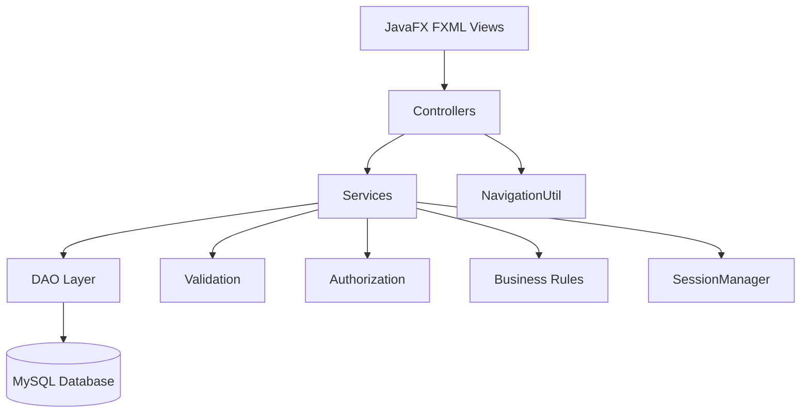
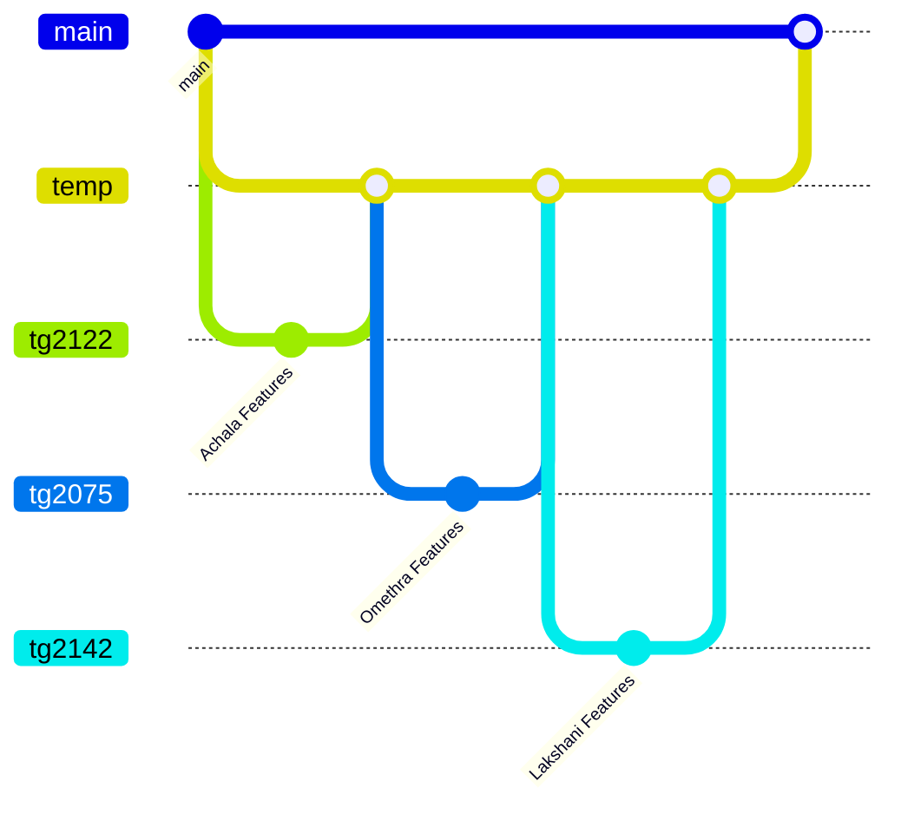
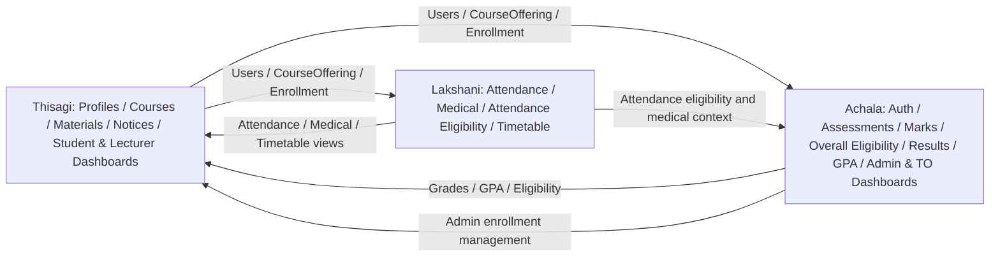

<div align="center">


<br/>


### 🎓 University of Ruhuna  
### 📘 ICT2132 — Object Oriented Programming Practicum  
### 👥 Group 14

</div>

---

## 🌟 About FTMS

**FTMS — Faculty of Technology Management System** is a JavaFX desktop application developed for the ICT2132 Object Oriented Programming Practicum.

The system is designed to manage the main academic and administrative operations required by the project specification, including:

- 👤 User profiles and role-based access
- 📚 Courses, course offerings, enrollments and course materials
- 📝 Assessments and undergraduate marks
- ✅ CA and overall eligibility
- 🎓 Final results, grades, SGPA and CGPA
- 📅 Theory and practical attendance
- 🩺 Medical records
- 📢 Notices
- 🗓️ Timetables
- 📊 Individual and batch academic summaries

The **team member responsibilities** in this README follow the handwritten task-allocation pages supplied by the team. The required features and academic constraints are based on the ICT2132 mini-project handout.

The project follows a layered design using:

```text
JavaFX View
    ↓
Controller
    ↓
Service
    ↓
DAO
    ↓
MySQL
```

---

## 👥 Group 14 Members & Module Allocation

The following **module responsibility allocation is based on the team's handwritten division of work**. It describes the areas each member is expected to present and explain during the individual evaluation; it is not a claim about Git commit authorship.

| Member | Registration No. | Assigned Module Areas | Main Responsibilities |
|---|---|---|---|
| **Achala Eshan** | `TG/2024/2122` | **Assessment, Marks, Results, Authentication & Administration** | Assessments; marks entry and updates; CA calculation; overall eligibility (attendance + CA); final results; grades and GPA; individual and batch academic reports; login/logout; password security; role-based access; Admin dashboard; Technical Officer dashboard; admin-side enrollment management |
| **Omethra Thisagi** | `TG/2024/2075` | **Profiles, Courses, Materials, Notices & Role Dashboards** | User profiles; courses; course offerings; course/student enrollment flows; course materials; notices; Student dashboard; Lecturer dashboard |
| **Lakshani Salgadu** | `TG/2024/2142` | **Attendance, Medical & Timetable** | Attendance session creation; theory/practical attendance; attendance percentages; individual and batch attendance summaries; medical records; medical approval; attendance eligibility; timetable |

> **Enrollment is mentioned under both Thisagi and Achala in the handwritten notes.** For clarity, this README separates **course enrollment data / student-facing enrollment flow (Thisagi)** from **Admin Enrollment Management (Achala)**. Both areas use the same shared enrollment records and must remain integrated. If your team intended a different split, update these two rows consistently.

### Role Dashboard Allocation

| Dashboard | Assigned Member |
|---|---|
| Admin Dashboard | **Achala Eshan** |
| Technical Officer Dashboard | **Achala Eshan** |
| Student Dashboard | **Omethra Thisagi** |
| Lecturer Dashboard | **Omethra Thisagi** |

---

## 🧩 Main Functional Modules

### 🔵 1. Login, Password Security & Role-Based Access — Achala

- Username/password authentication and login/logout workflow
- PBKDF2-based password hashing and verification
- Session creation, current-user tracking and session clearing on logout
- Active/inactive account checks and access restrictions
- Role-based navigation and authorization for `ADMIN`, `LECTURER`, `TECHNICAL_OFFICER` and `STUDENT`
- Admin Dashboard and Technical Officer Dashboard

**Main flow:** `login.fxml → LoginController → AuthService → UserDAO → PasswordUtil → SessionManager → NavigationUtil → Dashboard`.

**Relevant project classes:** `LoginController`, `AuthService`, `UserDAO`, `PasswordUtil`, `SessionManager`, `NavigationUtil`, `AdminDashboardController`, `TechnicalOfficerDashboardController`.

---

### 🟦 2. User Profiles & Courses — Thisagi

- User profile creation, maintenance and role-appropriate profile updates
- Admin maintenance of user accounts and their profiles
- Course and course-offering management
- Course/lecturer assignment relationships
- Enrollment records associated with course offerings and student course views
- Student Dashboard and Lecturer Dashboard
- Lecturer course materials and student read-only materials view/download

**Shared academic relationships:**

```text
Course
  ↓
CourseOffering
  ├── LecturerCourseAssignment
  ├── Enrollment
  ├── CourseMaterial
  ├── Assessment
  ├── AttendanceSession
  └── Timetable
```

**Relevant project areas:** profile, course, course offering, student course, course materials, and Student/Lecturer dashboard controllers, services and DAOs.

---

### 🟠 3. Enrollment — Shared Integration (Thisagi + Achala)

- **Thisagi:** course offering/enrollment relationships and student-facing enrolled-course views
- **Achala:** Admin Enrollment Management — enrolling a student, viewing records, and maintaining the enrollment status through the admin interface
- Both parts must respect user roles, course offerings, student records, data integrity and duplicate-enrollment validation

**Relevant project classes:** `EnrollmentDAO`, `AdminEnrollmentController`, `AdminEnrollmentService` and existing student course services.

---

### 🔴 4. Assessments, Marks, Results, Overall Eligibility & GPA — Achala

- Assessment creation, viewing, editing and deletion subject to relevant restrictions
- Assessment type, maximum marks, weight, date and descriptions
- Marks entry and update with validation (marks are recorded out of 100)
- Missing marks tracked separately from an entered numeric zero
- CA marks calculation and CA eligibility
- Overall eligibility combining the attendance eligibility input and CA eligibility
- Final results, subject-wise marks, grades and grade points
- SGPA and CGPA calculation
- Individual student reports and whole-batch academic summaries

**CA eligibility stated in the assignment:**

```text
CA >= 40%  → CA Eligible
CA < 40%   → CA Not Eligible
```

**General SGPA formula:**

```text
        Σ(Grade Point × Course Credits)
SGPA = ---------------------------------
                Σ Course Credits
```

**Relevant project classes:** `AssessmentsController`, `AssessmentService`, `AssessmentDAO`, `MarksController`, `MarkService`, `ResultsController`, `ResultService`, `GPAController`, `GPAService` and associated result/grade DAOs.

> Grade boundaries and grade points must follow **UGC Commission Circular No. 12-2024**. The exact academic rule implementation and repeat/fail/incomplete handling should be verified against the circular and project data.

---

### 🟢 5. Attendance Sessions, Records, Summaries & Eligibility — Lakshani

- Create and maintain attendance sessions for course offerings
- Maintain **15 theory** and **15 practical** sessions where the subject has both components
- Track attendance by undergraduate and by session
- Record theory-only, practical-only and combined attendance percentages
- Individual student and whole-batch attendance summaries
- Attendance eligibility evaluation and provision of attendance status to the overall eligibility workflow
- Role-scoped attendance viewing (Technical Officer, Lecturer, Student)

**Assignment assumptions:**

```text
Theory sessions:    15
Practical sessions: 15
1T session:         2 hours
1P session:         2 hours
```

**Required test scenarios:**

```text
> 80% attendance
= 80% attendance
< 80% attendance without medical
> 80% attendance with medical
< 80% attendance with medical
```

> These are the five **test scenarios** specified in the mini-project handout. The handout does not explicitly define a final attendance eligibility cutoff or how approved medicals change that cutoff; those rules must not be assumed without confirmation.

---

### 🩺 6. Medical Records & Approval — Lakshani

- Record and maintain undergraduate medical details
- Track medical approval statuses (`PENDING`, `APPROVED`, `REJECTED`)
- Link approved/unapproved medical information to relevant absences, where supported
- Allow appropriate Lecturer/Technical Officer views and student own-record views
- Supply relevant medical context to the attendance eligibility workflow

---

### 🟡 7. Timetable — Lakshani

- Admin timetable creation, updates and deletion
- Technical Officer department-specific timetable views
- Student timetable view for enrolled courses
- Day, location, start/end time and course-offering validation
- Appropriate department and course filters

---

### 📢 8. Notices — Thisagi

- Admin notice creation, viewing, editing and deletion
- Published notices visible to permitted Lecturer, Technical Officer and Student roles
- Notice listing and audience/role restrictions supported by the application

---

### 🎓 9. Role-Specific Dashboard Integration — Achala & Thisagi

| Dashboard | Owner | Integration Focus |
|---|---|---|
| Admin | **Achala** | Administration, enrollment management, user/course/notice/timetable navigation |
| Technical Officer | **Achala** | Attendance, medical, departmental timetable and notices |
| Lecturer | **Thisagi** | Course materials, assessments/marks, academic views, notices, attendance and medical views |
| Student | **Thisagi** | Enrolled courses/materials, attendance, medicals, grades/GPA, timetable and notices |

Dashboard ownership here refers to the notebook allocation; the linked functional modules are shared between members.

---

## 🏗️ System Architecture



### Layer Responsibilities

| Layer | Responsibility |
|---|---|
| **Model** | Encapsulated domain data and entity behavior |
| **DAO** | JDBC, SQL, `PreparedStatement`, `ResultSet`, persistence |
| **Service** | Validation, permissions, calculations and business rules |
| **Controller** | JavaFX event handling, form/table binding, alerts |
| **FXML/CSS** | User interface and visual styling |
| **Database** | MySQL relational storage and constraints |

---

## 🧠 OOP Concepts Demonstrated

The project is structured to demonstrate the individual evaluation requirements.

| OOP / Technical Area | Project Evidence |
|---|---|
| **Classes & Objects** | `User`, `Course`, `Assessment`, `Mark`, `AttendanceRecord`, `Medical`, etc. |
| **Encapsulation** | Private fields + getters/setters + service-controlled updates |
| **Inheritance** | `Admin`, `Lecturer`, `TechnicalOfficer`, `Undergraduate` extend `User` |
| **Abstraction** | Abstract `User`, report/service/DAO abstractions |
| **Polymorphism** | `User` references to concrete roles; report implementations |
| **Exception Handling** | Custom exceptions + controller-side user-friendly handling |
| **Database Handling** | DAO classes, JDBC, transactions, `PreparedStatement` |
| **GUI** | JavaFX + FXML + CSS + TableView/ComboBox/DatePicker |

---

## 🗃️ Database Design

Database name:

```sql
ftms_group14
```

Main tables:

```text
departments
users
admins
lecturers
technical_officers
undergraduates
courses
course_offerings
lecturer_course_assignments
enrollments
course_materials
assessments
marks
attendance_sessions
medicals
attendance_records
grade_rules
course_results
semester_results
notices
timetables
```

### Database Files

Recommended repository location:

```text
docs/database/
├── 01_ftms_group14_schema.sql
└── 02_ftms_group14_seed_data.sql
```

Run order:

```text
1. 01_ftms_group14_schema.sql
2. 02_ftms_group14_seed_data.sql
```

---

## 🌱 Demo / Seed Data

The development seed data is designed to provide:

- `1` Admin
- `5` Lecturers
- `4` Technical Officers
- `20` Undergraduates
- Regular students
- Repeat students
- Batch-missed students
- Courses and Course Offerings
- Lecturer assignments
- Enrollments
- Assessments
- Sample marks
- `15 Theory + 15 Practical` attendance sessions
- Mandatory attendance test scenarios
- Medical records
- Notices
- Timetable records

### Demo Login

```text
Username: admin
Password: Ftms@123
```

> Demo credentials are only for local development/testing.

---

## 🔐 Database Configuration

Create:

```text
src/main/resources/application.properties
```

Example:

```properties
db.url=jdbc:mysql://localhost:3306/ftms_group14
db.username=root
db.password=YOUR_MYSQL_PASSWORD
```

Do **not** commit the real configuration file.

Add to `.gitignore`:

```gitignore
src/main/resources/application.properties
.env
.env.*
```

Recommended team-safe template:

```text
src/main/resources/application.properties.example
```

---

## 📁 Recommended Project Structure

```text
OOPP_Group_14/
│
├── docs/
│   ├── SRS/
│   ├── ER_Diagram/
│   ├── Class_Diagram/
│   └── database/
│       ├── 01_ftms_group14_schema.sql
│       └── 02_ftms_group14_seed_data.sql
│
├── src/
│   └── main/
│       ├── java/
│       │   └── lk/ac/ruhuna/ftms/
│       │       ├── MainApp.java
│       │       ├── Launcher.java
│       │       ├── controller/
│       │       ├── dao/
│       │       ├── database/
│       │       ├── exception/
│       │       ├── model/
│       │       ├── service/
│       │       └── util/
│       │
│       └── resources/
│           ├── fxml/
│           ├── css/
│           ├── images/
│           └── application.properties
│
├── .gitignore
├── pom.xml
└── README.md
```

---

## 🧰 Technology Stack

| Technology | Usage |
|---|---|
| **Java 25** | Core application logic |
| **JavaFX 25** | Desktop GUI |
| **FXML** | UI layout |
| **CSS** | JavaFX styling |
| **Maven** | Dependency and build management |
| **MySQL** | Relational database |
| **JDBC** | Java–MySQL communication |
| **IntelliJ IDEA** | Development IDE |
| **Git** | Version control |
| **GitHub** | Repository, pull requests and collaboration |

---

## 📦 Maven Dependencies

Core dependencies:

```xml
<dependency>
    <groupId>org.openjfx</groupId>
    <artifactId>javafx-controls</artifactId>
    <version>25</version>
</dependency>

<dependency>
    <groupId>org.openjfx</groupId>
    <artifactId>javafx-fxml</artifactId>
    <version>25</version>
</dependency>

<dependency>
    <groupId>com.mysql</groupId>
    <artifactId>mysql-connector-j</artifactId>
    <version>9.4.0</version>
</dependency>
```

---

## ▶️ How to Run

### 1. Clone the repository

```bash
git clone https://github.com/Achalaz/OOPP-2026-GP-14.git
cd OOPP-2026-GP-14
```

### 2. Configure MySQL

Run:

```text
docs/database/01_ftms_group14_schema.sql
docs/database/02_ftms_group14_seed_data.sql
```

### 3. Configure local database credentials

Create:

```text
src/main/resources/application.properties
```

### 4. Build

```bash
mvn clean verify
```

Expected:

```text
BUILD SUCCESS
```

### 5. Run

From IntelliJ:

```text
Launcher.java
→ Run Launcher.main()
```

Current direct-run launcher:

```java
package lk.ac.ruhuna.ftms;

public class Launcher {
    public static void main(String[] args) {
        MainApp.main(args);
    }
}
```

Recommended VM option for JDK 25:

```text
--enable-native-access=ALL-UNNAMED
```

---

## ✅ Development Snapshot (Reported Progress)

The original README reports the following progress. These items were **not re-tested** when this README was edited:

```text
✅ Java 25 / Maven project setup
✅ JavaFX dependencies configured
✅ Launcher-based JavaFX startup
✅ MySQL JDBC dependency configured
✅ DBConnection setup
✅ Consolidated FTMS database schema prepared
✅ Demo/test seed data prepared
✅ Marks Entry JavaFX screen working
✅ Marks loaded from MySQL into TableView
✅ Marks Save / Update structure
✅ Marks validation structure
```

Source files for the major functional areas are present in the project snapshot. Functional completeness, database connectivity and role-specific UI behavior still require live verification before declaring the application finished.

---

## 🧪 Testing Checklist

### Authentication

```text
[ ] Correct login
[ ] Wrong password
[ ] Unknown username
[ ] Inactive account
[ ] Role routing
[ ] Logout clears session
```

### Marks

```text
[ ] 0 accepted
[ ] 40 accepted
[ ] 100 accepted
[ ] negative mark rejected
[ ] >100 rejected
[ ] missing mark handled separately
[ ] duplicate mark prevented / updated
```

### CA

```text
[ ] 39.99 → Not Eligible
[ ] 40.00 → Eligible
[ ] 40.01 → Eligible
```

### Attendance

```text
[ ] 15 Theory sessions
[ ] 15 Practical sessions
[ ] Theory %
[ ] Practical %
[ ] Combined %
[ ] >80 test scenario
[ ] =80 test scenario
[ ] <80 no-medical scenario
[ ] >80 with-medical scenario
[ ] <80 with-medical scenario
```

### Medical

```text
[ ] Pending
[ ] Approved
[ ] Rejected
[ ] Link to absence record
[ ] Student own-view restriction
```

### Timetable

```text
[ ] Admin CRUD
[ ] TO own department only
[ ] Student own enrolled courses only
[ ] Invalid time range rejected
```

### Build

```bash
mvn clean verify
```

---

## 🔀 Git Workflow

Each member develops on their own branch:

```text
tg2122 → Achala
tg2075 → Omethra
tg2142 → Lakshani
```

Integration flow:



Recommended flow:

```text
Member Branch
     ↓
Pull Request
     ↓
temp
     ↓
Integration Testing
     ↓
Pull Request
     ↓
main
```

---

## 🧾 Recommended Commit Style

Examples:

```bash
git commit -m "Add FTMS database schema and seed data"
git commit -m "Complete marks entry CRUD with validation"
git commit -m "Add CA calculation and eligibility"
git commit -m "Add attendance session management"
git commit -m "Add secure authentication and session management"
git commit -m "Add timetable management and role filtering"
```

---

## 🔒 Security Practices

- Passwords are not stored as plaintext
- PBKDF2-based password hashing
- Random salt per password
- `PreparedStatement` used for SQL parameters
- No MySQL password committed to Git
- Role permissions enforced in service layer
- Session cleared during logout
- Generic login failure messages
- Application secrets ignored using `.gitignore`
- Historical academic data protected with restrictive FK behavior

---

## 📊 FTMS Module Interaction



### Integrated Academic Workflow

```text
User logs in (Achala)
    ↓
Role dashboard (Achala: Admin/TO; Thisagi: Student/Lecturer)
    ↓
Course offering + student enrollment data (Thisagi; admin maintenance: Achala)
    ├── Course materials / notices (Thisagi)
    ├── Assessments → marks → CA → results / GPA (Achala)
    └── Attendance sessions → attendance / medicals → attendance eligibility (Lakshani)
                                                        ↓
                                  Overall eligibility: CA + attendance (Achala)
```

---

## 📌 Important Project Rules

### Confirmed

```text
✔ All marks are out of 100
✔ CA eligibility = CA >= 40%
✔ 15 Theory sessions
✔ 15 Practical sessions
✔ Theory session = 2 hours
✔ Practical session = 2 hours
✔ Individual and batch summaries required
✔ Grade according to UGC Circular No. 12-2024
✔ SGPA / CGPA required
```

### TBC / Must Be Confirmed

```text
⚠ Exact attendance eligibility cutoff
⚠ Effect of approved medicals on attendance eligibility
⚠ Exact UGC Circular 12-2024 grade boundaries and grade points
⚠ Repeat/fail/incomplete treatment in SGPA/CGPA
⚠ Enrollment maintenance actor if not confirmed
```

These rules should remain configurable or pending until confirmed.

---

## 📚 Project Documentation

The repository should contain:

```text
docs/
├── SRS/
├── ER_Diagram/
├── Class_Diagram/
└── database/
```

Recommended final documentation:

- Software Requirements Specification
- ER Diagram
- Class Diagram
- Consolidated MySQL Schema
- Seed/Test Data
- Final Project Report
- Individual Contribution Pages

---

## 🗓️ Submission & Evaluation (Project Handout)

- **Project report and Git repository source code:** **1 November 2026, 11:59 p.m.** (as stated in the handout)
- **Individual contributions:** **one page per group member** in the submitted report
- **Group evaluation:** **5 November 2026** — 15-minute presentation and 10-minute discussion
- **Individual code evaluation:** each member explains and demonstrates their own contribution

The notebook-based ownership table above can be used as the starting point for those three individual contribution pages, but each member should verify the final claimed work against their actual code and Git history.

---

## 🎯 Final Evaluation Preparation

Every member should be able to demonstrate:

```text
Classes and Objects
Inheritance
Abstraction
Polymorphism
Encapsulation
Exception Handling
Database Handling
GUI
```

Each member should explain their own:

```text
FXML
  ↓
Controller
  ↓
Service
  ↓
DAO
  ↓
MySQL
```

---

## 📈 Development Status

<div align="center">


</div>

---

## 🤝 Team Development Rules

1. Work only on your assigned branch.
2. Pull/rebase before pushing.
3. Keep feature commits small and clear.
4. Do not force-push shared branches.
5. Do not duplicate shared entities.
6. Do not commit database passwords.
7. Test before opening a PR.
8. Merge member branches into `temp` first.
9. Perform team integration testing.
10. Merge `temp` into `main` only after verification.

---

## 💻 Repository

<div align="center">

### [OOPP-2026-GP-14](https://github.com/Achalaz/OOPP-2026-GP-14)

**Faculty of Technology Management System — Group 14**

Built with Java • JavaFX • Maven • MySQL

</div>

---

## 📜 Academic Note

This project is developed for the **ICT2132 Object Oriented Programming Practicum** at the **University of Ruhuna**.

All demo data is for development/testing purposes. Academic rules that are not explicitly confirmed in the project specification must not be guessed or silently hard-coded.

---

<div align="center">


### ⭐ ICT2132 • Group 14 • University of Ruhuna

</div>
